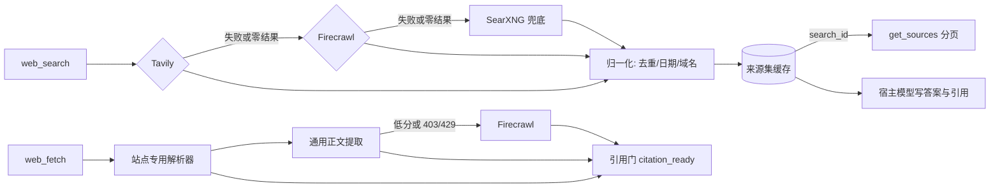

# search-gateway

[](LICENSE)
[](https://www.rust-lang.org/)
[](https://github.com/lethe-river/search-gateway/actions/workflows/ci.yml)
[](https://github.com/lethe-river/search-gateway/releases)
[](https://linux.do)

**只做检索的 MCP 服务。** 把 Tavily、Firecrawl、SearXNG 的结果归一化成「来源」交给宿主模型，
答案和引用由模型自己写。

- 不生成答案、不做摘要、不判断「哪个来源更对」——这三件事交给宿主模型
- 搜索链：Tavily → Firecrawl（补位/故障转移）→ SearXNG（前两者全部失败或零结果时兜底）
- 抓取链：站点专用解析器 → 通用正文提取 → Firecrawl
- 提供方失败不装死：每个工具都有明确的 `isError` 语义和 `provider_errors` 错误码

## 为什么需要它

| 常见做法 | 问题 | 本服务的处理 |
| --- | --- | --- |
| 给 agent 装三个官方 MCP 服务器 | 三套返回格式、三套错误语义，模型自己猜 | 一个入口，归一化成同一份来源结构 |
| 单 key 直连提供方 | 一次 429 就让整轮检索失败 | 多 key 轮询 + 按错误类型冷却 + 按操作熔断 |
| 让搜索服务直接给答案 | 你分不清哪句话有出处 | 只返回来源，附 `citation_ready` 引用门 |

## 亮点

1. **多 key 轮询**：一个环境变量里放多个 key 即可自动轮询，按错误类型分别冷却（认证 10 分钟、
   配额 1 小时、限流 1 分钟，响应带 `Retry-After` 时优先采用）。某个 key 被限流时，其余 key 自动接替。
2. **熔断按操作隔离**：`tavily.search`、`tavily.map`、`firecrawl.scrape`、`searxng.search` 各自独立，
   一个操作失败不会拖垮另一个。
3. **引用门**：`web_fetch` 返回 `citation_ready`、`quality_score`、`citation_caveat`；低质量、源站 4xx、
   页面截断都会显式降级，不允许悄悄当成已读证据。
4. **失败可诊断**：19 种错误码 + `provider_errors` + `retry_after_secs`，agent 能分清
   「该重试」「该换源」还是「该报告」。
5. **缓存与分页**：查询 LRU（默认 600 秒 / 32 条）+ 来源集可持久化，`get_sources` 按 `search_id`
   分页读，被响应预算裁掉的来源仍可取回。
6. **SSRF 防护**：默认拒绝 loopback、私有网段、link-local、multicast，重定向逐跳复检。

## 快速入门（Windows，5 分钟）

1. **下载解压**：在 [Releases](https://github.com/lethe-river/search-gateway/releases) 取
   `search-gateway-0.2.0-x86_64-pc-windows-msvc.zip`，解压到固定目录（路径不要带空格），
   例如 `D:\tools\search-gateway\`。想校验文件完整性，同页有 `SHA256SUMS.txt`。

2. **写配置**：把 [`config.example.toml`](config.example.toml) 复制到
   `%APPDATA%\search-gateway\config.toml`，填入 Tavily / Firecrawl 的 key。key 直接写进文件最省事
   —— MCP 客户端拉起子进程时不一定继承你的环境变量，用 `env:` 反而容易踩坑。

3. **自检**（不消耗任何额度）：

   ```powershell
   D:\tools\search-gateway\search-gateway.exe --doctor
   ```

4. **注册给 MCP 客户端**（以 Claude Code 为例）：

   ```powershell
   claude mcp add --scope user search-gateway -- "D:\tools\search-gateway\search-gateway.exe"
   ```

   等价于手写 `{"command": "D:\\tools\\search-gateway\\search-gateway.exe", "args": []}`。

5. **验证**：在会话里让它 `web_search` 一次。

> **最常见的坑**：`command` 必须是可执行文件的绝对路径。用 `cargo run` 会把 cargo 的构建输出
> 混进 stdout，MCP 的 stdio 握手立刻失败。

零成本兜底：用 [`deploy/searxng/`](deploy/searxng/) 的 compose 在本机起一个 SearXNG，
付费链全挂时仍有结果，见 [`docs/searxng-fallback.md`](docs/searxng-fallback.md)。

## Agent 集成（可移植）

仓库自带 skill 和标准提示词，目标是在另一台电脑、本机另一个 agent 或另一个 profile 上使用
同一套检索与引用标准，而不是每台机器各写一套。

| 文件 | 作用 |
| --- | --- |
| [`skills/search-gateway/SKILL.md`](skills/search-gateway/SKILL.md) | 检索/引用工作流、工具参考、错误处理 |
| [`skills/search-gateway/references/agent-prompt.md`](skills/search-gateway/references/agent-prompt.md) | 全局提示词 §1/§1b 的唯一来源 |
| [`skills/search-gateway/references/answer-quality.md`](skills/search-gateway/references/answer-quality.md) | 引用审计清单与评分标准 |
| [`skills/search-gateway/references/portable-setup.md`](skills/search-gateway/references/portable-setup.md) | 跨机器安装、验证、漂移检查 |
| [`skills/search-gateway/scripts/install.ps1`](skills/search-gateway/scripts/install.ps1) / [`install.sh`](skills/search-gateway/scripts/install.sh) | 把 skill 安装/覆盖到用户目录 |
| [`config.example.toml`](config.example.toml) | 无密钥配置模板 |

`references/search-routing-policy.md` 只是指向 `agent-prompt.md` 的指针，不维护第二份策略。

安装 skill：

```powershell
# Windows
.\skills\search-gateway\scripts\install.ps1 -Force
```

```bash
# Linux/macOS
./skills/search-gateway/scripts/install.sh --force
```

然后把 `agent-prompt.md` 的 §1/§1b 复制进 `~/.claude/CLAUDE.md`，按 `portable-setup.md`
注册 MCP、配置权限并运行 `doctor`。**标准层只改仓库**：路径、端口、key、代理网段放在本地
`config.toml`，不要写进 skill 或全局提示词。

**发布组合**：release 二进制（工具描述与字段）、`~/.claude/skills/search-gateway`、
`~/.claude/CLAUDE.md` 的 §1/§1b 必须同版。改仓库后重新构建、重装 skill、同步全局提示词；
只更新一层会出现「skill 有硬门、二进制或提示词没有」的漂移。

验收按 `answer-quality.md` 的 8 项检查，不只看「有没有来源列表」。硬门是数字/日期覆盖、
URL 溯源、来源身份、抓取质量、独立性；另外检查冲突、检索记录、URL 精确性。任何一项不过，
不算 A 级。

一次真实任务的复盘见 [`docs/validation.md`](docs/validation.md)。

## 五个工具

| 工具 | 作用 | 常用参数 |
| --- | --- | --- |
| `web_search` | 搜索并返回归一化来源 | `query`、`max_results` 1–50、`recency_days` 1–365、`fresh` |
| `web_fetch` | 抓取单个 URL，返回 Markdown，长文可分页续读 | `url`、`max_chars`、`fetch_id`、`offset` |
| `web_map` | 发现站点 URL | `url`、`max_results` 1–200 |
| `get_sources` | 按 `search_id` 分页读上次搜索的完整来源集，不重新搜索 | `search_id`、`offset`、`limit` |
| `doctor` | 检查配置、keyring、熔断器、SearXNG 健康与引擎状态 | `live` |

<details>
<summary>参数细节、<code>isError</code> 判定与错误码（点开）</summary>

完整参数语义、响应整形与截断预算、`get_sources` 分页规则、`citation_ready` 判定、
`recency_days` 的本地二次过滤、19 种错误码，以及每个工具在什么情况下返回 `isError=true`，
都在 [`docs/tool-reference.md`](docs/tool-reference.md)。

</details>

## 调用链



## 配置

最小可用（只用 Tavily + 本机 SearXNG 兜底）：

```toml
[tavily]
keys = ["env:TAVILY_API_KEY"]   # 逗号分隔即可放多个：tvly-a,tvly-b

[searxng]
enabled = true
base_url = "http://127.0.0.1:12310"
```

配置路径优先级、全部字段与默认值见 [`docs/configuration.md`](docs/configuration.md)。

## 它不做什么

- **不生成答案**：返回来源，不返回结论。引用、判断、写作由宿主模型完成。
- **不排名**：不判断「哪个来源更好」，只做归一化、去重与过滤。
- **不做账号与计费**：只使用你配置的 key。

## 已知边界

- 只在 **Windows** 上实测。Linux/macOS 有 CI 构建产物（5 个 target），但**未经我手动验证**。
- 本地构建需要 Rust GNU target 与完整的 MinGW-w64 binutils，见 [`docs/build.md`](docs/build.md)。
- 不解析 `robots.txt`；PDF 与需要 JavaScript 渲染的页面依赖 Firecrawl。
- DNS 重绑定未防护：首次 SSRF 校验通过后解析结果发生变化的情况不拦截。

## 文档

| 文档 | 内容 |
| --- | --- |
| [`docs/configuration.md`](docs/configuration.md) | 配置路径优先级、全部字段、多 key 解析 |
| [`docs/tool-reference.md`](docs/tool-reference.md) | 参数语义、响应整形、`isError` 契约、错误码 |
| [`docs/build.md`](docs/build.md) | 构建环境、MinGW、`--doctor` / `--selftest` 用法 |
| [`docs/validation.md`](docs/validation.md) | 一次真实检索任务的复盘（含自评为 C+ 的部分） |
| [`docs/adr/`](docs/adr/) | 设计决策：只做检索、keyring 冷却、SearXNG 兜底、响应契约 |
| [`skills/search-gateway/`](skills/search-gateway/) | 让 agent 用对这套工具的 skill 与提示词 |
| [`CONTEXT.md`](CONTEXT.md) | 术语表：检索、来源、引用、宿主模型等词的定义 |

## 许可

MIT。本项目认可并链接 [LINUX DO](https://linux.do) 社区。
